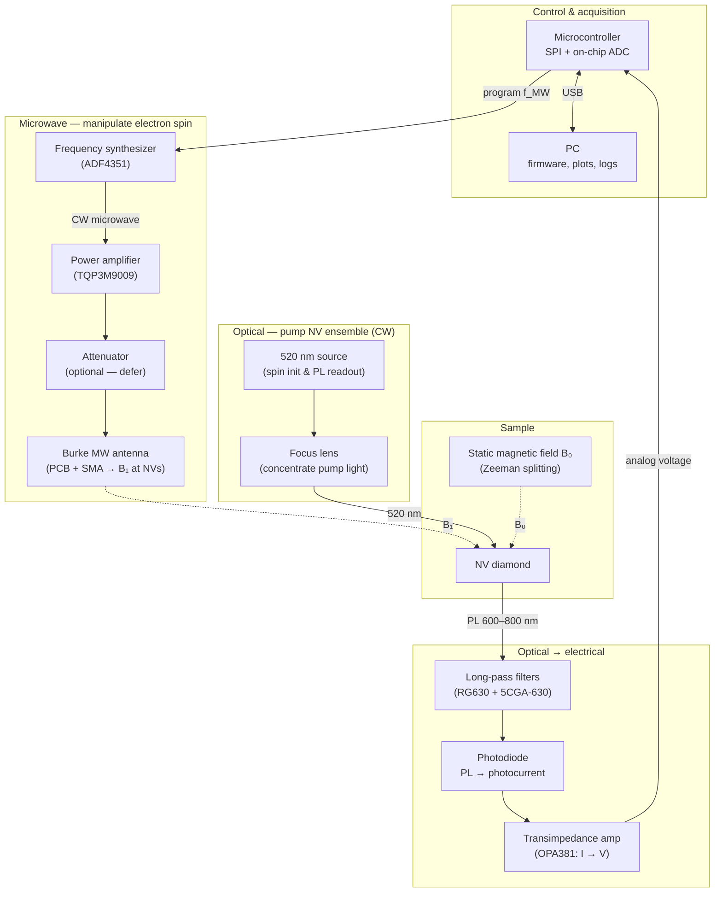
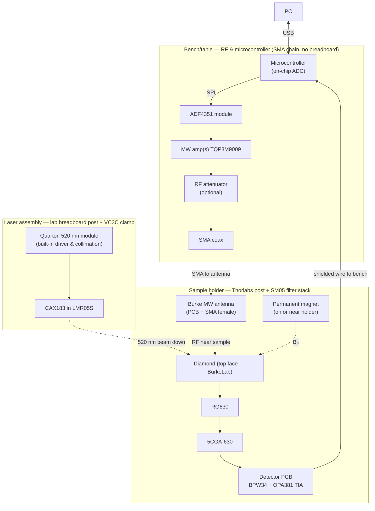

## Apparatus diagram (team design)

Hybrid of **CW ODMR** from Zhang et al., *Little bits of diamond* ([Am. J. Phys. 86, 225 (2018)](https://doi.org/10.1119/1.5023389)) with **automated MW** (ADF4351 + microcontroller) and **compact detection** from Mariani et al. ([AIP Advances 12, 065321 (2022)](https://doi.org/10.1063/5.0089161)).

**BOM:** [../parts_list.md](../parts_list.md) · **Goals:** [../goals.md](../goals.md)

Two views of the same apparatus:


| View           | Section                               | Use when                                     |
| -------------- | ------------------------------------- | -------------------------------------------- |
| **Conceptual** | [below](#conceptual-signal--function) | Physics, reports, “what does this block do?” |
| **Physical**   | [below](#physical-build--layout)      | Assembly, Thorlabs mounts, bench layout      |
| **Costs**      | [parts_diagram_cost.md](parts_diagram_cost.md) | Budget, orders, per-block $                  |


### Cross-reference (conceptual ↔ physical)


| Conceptual role                     | Physical where it lives                                            |
| ----------------------------------- | ------------------------------------------------------------------ |
| Microcontroller + ADC + USB logging | **Bench** — CTL module; USB to PC                                  |
| Synthesizer (set MW frequency)      | **Bench** — ADF4351                                                |
| Amplifier (attenuator optional)     | **Bench/table** — TQP3M9009; SMA coax to Burke antenna             |
| MW antenna (RF → B₁)                | **Holder** — Burke PCB + SMA female (supplied)                     |
| 520 nm pump + focus                 | **Laser assembly** — Quarton + CAX183                              |
| NV sample + B₀                      | **Holder** — diamond + magnet                                      |
| Filter stack (PL band)              | **Holder** — RG630, 5CGA-630 in stack                              |
| Photodiode + TIA                    | **Holder** — detector PCB (bottom of stack)                        |
| Oscilloscope                        | **Lab only** — optional probe on TIA output (not in PoC data path) |


---


## Conceptual (signal & function)

**Measurement:** CW laser on → sweep **MW frequency** → NV photoluminescence (PL) changes at resonance → log **PL vs f** via microcontroller ADC.




→ Physical placement of these blocks: [Physical build](#physical-build--layout)

---


## Physical (build & layout)

**Three things you assemble / wire:** laser assembly, sample holder (optics + Burke antenna), bench/table RF + microcontroller (SMA chain).




→ What each block *does*: [Conceptual](#conceptual-signal--function)

### What each subassembly is


| Build unit         | Parts inside                                                                       | How it connects                                                                            |
| ------------------ | ---------------------------------------------------------------------------------- | ------------------------------------------------------------------------------------------ |
| **Laser assembly** | **VC3C** + Quarton on **TR/PH**; **LMR05S** + CAX183 on second post              | Aim at **top** of diamond; posts on **lab MB4** (or equivalent)                            |
| **Sample holder**  | **SM05L10** + RG630 + 5CGA-630; diamond; **lab perfboard** PD+TIA; **Burke antenna** | **SMA coax** to Burke **SMA female**; **shielded** analog to CTL                         |
| **MW bench**       | ADF4351, amp(s), optional att, **SMA coax** on table                               | **Synth → amp → (att) → coax → Burke antenna**; CTL **USB** to PC; lab PSUs              |


### Stack (top → bottom on the holder)

```text
  [ laser beam from above ]
           ↓
      ┌─────────┐
      │ Diamond │  ← top face illuminated
      ├─────────┤
      │  RG630  │
      ├─────────┤
      │ 5CGA-630│
      ├─────────┤
      │  BPW34  │  ← same PCB as OPA381 (TIA)
      │ OPA381  │
      └─────────┘
   Burke MW antenna (SMA) ── RF near diamond / PL region
```


### Build & bring-up order

1. **Detector PCB** — solder BPW34 + OPA381; verify TIA output (no diamond yet).
2. **Holder** — stack filters; diamond on top; **lab perfboard** PD+TIA; mount **Burke antenna** near sample; add magnet.
3. **Laser assembly** — align beam on diamond top face.
4. **Bench RF** — synth → amp → (att if needed) → **SMA coax** → Burke **SMA female**; **low power** first.
5. **Microcontroller** — SPI frequency sweeps + ADC readout; log PL vs frequency.


### Electrical notes

- **ADC** is inside the microcontroller; detector PCB provides **voltage** to an analog input.  
- Match **ADF4351 SPI logic** (often 3.3 V) to CTL I/O.  
- Short **shielded** run from detector PCB to bench CTL; scope optional on TIA out for lab debug only.


### December target

Assembled **three subassemblies** + CW ODMR PoC — see [goals.md](goals.md).