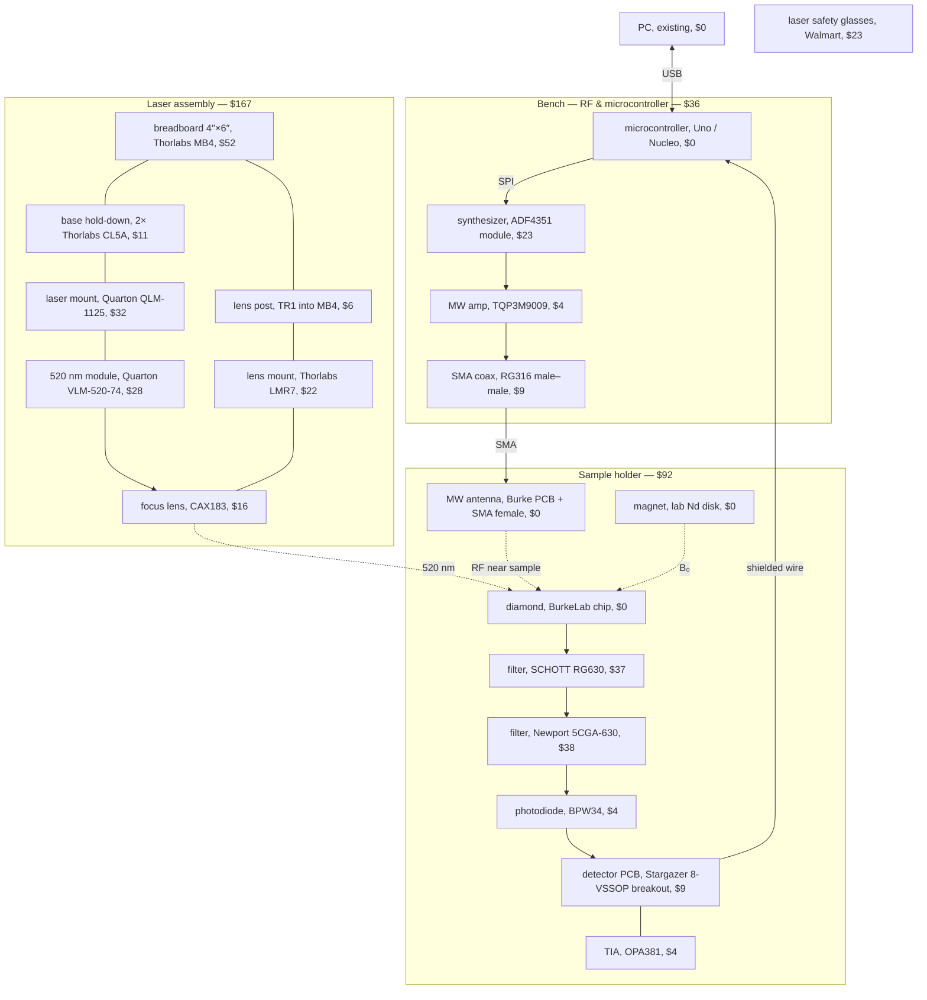

## Apparatus diagram — with costs

Parts we are buying now, placed where they go in the build. **Node format:** `role, part, $` (list USD). **$0** = BurkeLab, EECS lab, or team stock. Order details: [../parts_list.md](../parts_list.md).

| Block | $ |
|-------|---|
| Bench | 36 |
| Laser assembly | 167 |
| Sample holder | 92 |
| Safety glasses | 23 |
| **Total (list, before tax/shipping)** | **318** |
