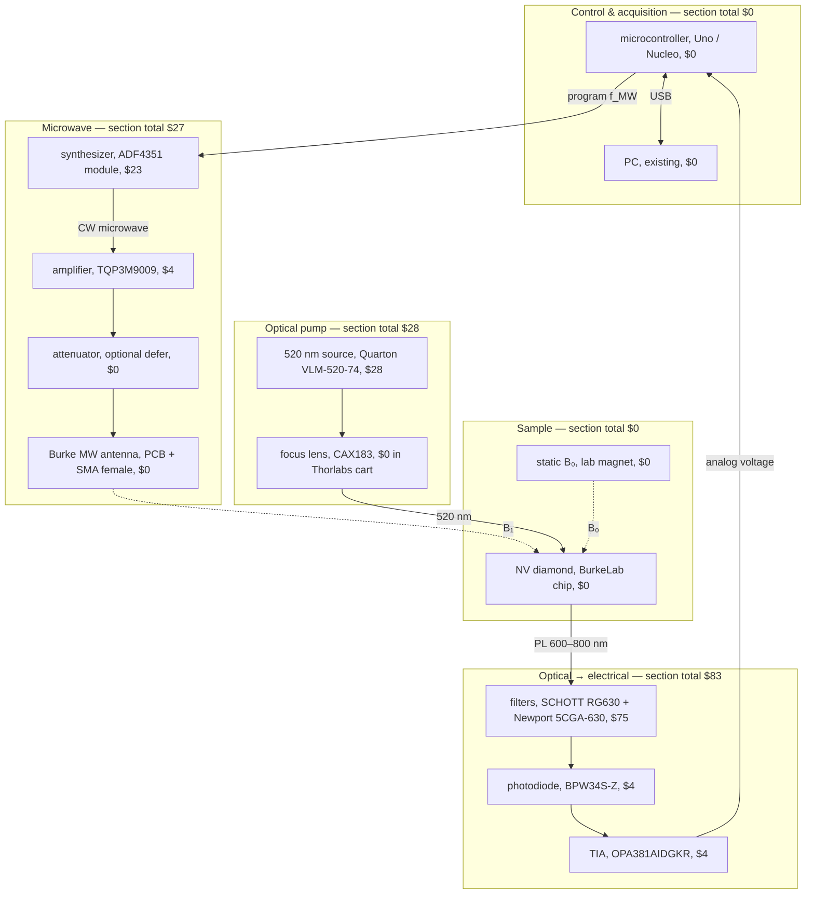
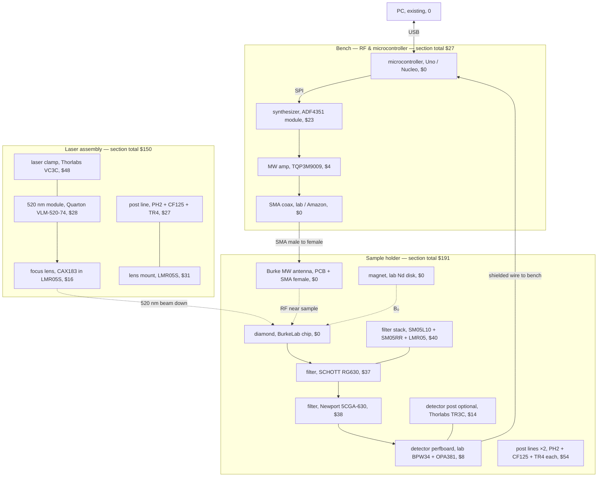

## Apparatus diagram — with costs (team design)

Same layout as [parts_diagram.md](parts_diagram.md). **Line format:** `role, part / MPN, ext $` (list USD). **$0** = BurkeLab, EECS lab, or team stock unless noted.

**BOM detail:** [../parts_list.md](../parts_list.md) · **No-cost views:** [parts_diagram.md](parts_diagram.md)

| View | Section |
|------|---------|
| **Conceptual** | [below](#conceptual-signal--function-costs) |
| **Physical** | [below](#physical-build--layout-costs) |

**Pricing scope:** P0 parts you **buy** (1× MW amp; attenuator **deferred**; no custom wire-launch PCB; no PCB-mount SMA). **MB4** from lab (not in Thorlabs cart). Team checkout reference: **Amazon ~$102**, **program ~$572** (Oct 2026, incl. tax/shipping on some vendors).

---

## Conceptual (signal & function) — costs



| Section | Subtotal (USD) |
|---------|----------------|
| Control & acquisition | **0** |
| Microwave (purchased) | **27** |
| Optical pump (Amazon laser only) | **28** |
| Sample | **0** |
| Detection | **83** |
| **Conceptual subassemblies (excludes Thorlabs mechanics & safety)** | **138** |

*Attenuator (~$16) omitted — add only if power is too high. **CAX183** ($16) is in the Thorlabs subtotal below.*

---

## Physical (build & layout) — costs

Thorlabs lines match [thorlabs_cart_p0.csv](../thorlabs_cart_p0.csv) (no **MB4**). MW chain on bench/table via **SMA coax** (lab or Amazon **M4**); **Burke antenna** at holder.



| Build unit | Subtotal (USD) | Notes |
|------------|----------------|--------|
| **Bench** | **27** | ADF4351 + 1× amp; CTL + coax at $0 (lab); no breadboard for RF |
| **Laser assembly** | **150** | Quarton + CAX183 + VC3C + LMR05S + one post line |
| **Sample holder** | **191** | Filters + SM05 stack + detector ICs + TR3C + two post lines; Burke antenna $0 |
| **Physical subassemblies** | **368** | Excludes safety glasses ($23); **MB4** lab loan for posts |

---

## Overall (P0 team purchase)

| Category | Ext $ |
|----------|-------|
| Purchased MW + optics modules + filters + detector ICs (no Thorlabs) | **138** |
| Thorlabs optomechanics + CAX183 ([cart CSV](../thorlabs_cart_p0.csv), no MB4) | **~231** |
| Laser safety glasses (Walmart O3) | **23** |
| **Overall P0 list (before tax/shipping)** | **~392** |

| Removed vs earlier BOM | Savings (list) |
|------------------------|----------------|
| **MB4** (lab breadboard) | ~52 |
| **M3** attenuator (defer) | ~16 |
| **M5** PCB-mount SMA (on Burke antenna) | ~9 |
| **M6** custom wire-launch PCB (Burke antenna) | ~15 |

Add **~10–15% + shipping**; optional **SPW603** spanner (+$13–37) and **2nd TQP3M9009** (+$4) not included. **Amazon wishlist (MW + laser):** team checkout **~$102** (Oct 2026).

Full vendor tables: [parts_list.md](../parts_list.md#orders-by-vendor).

### Stack (top → bottom) — line items

```text
  [ laser beam from above ]
           ↓
      ┌─────────┐
      │ Diamond │  sample, BurkeLab, $0
      ├─────────┤
      │  RG630  │  filter, SCHOTT RG630, $37
      ├─────────┤
      │ 5CGA-630│  filter, Newport 5CGA-630, $38
      ├─────────┤
      │  BPW34  │  photodiode, BPW34S-Z, $4
      │ OPA381  │  TIA, OPA381AIDGKR, $4
      └─────────┘
   Burke MW antenna (SMA), $0 · SM05/LMR05/TR3C/mechanics in holder subtotal
```

### Microwave cable chain (purchased path)

```text
ADF4351 → TQP3M9009 → [attenuator if needed] → SMA coax → Burke antenna (SMA female)
```
