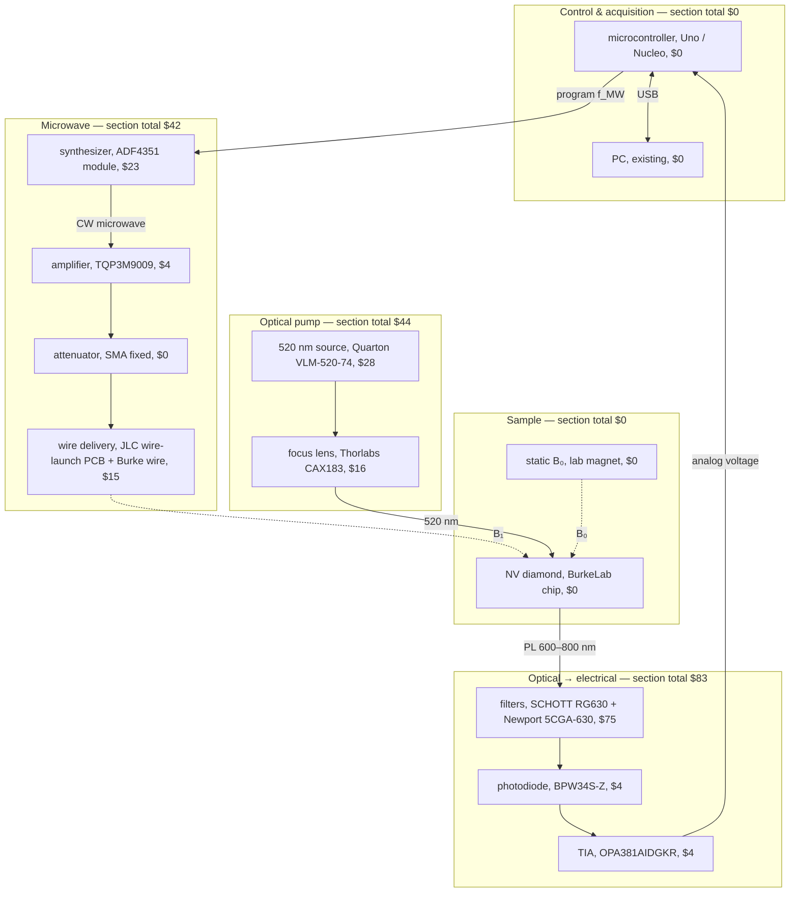
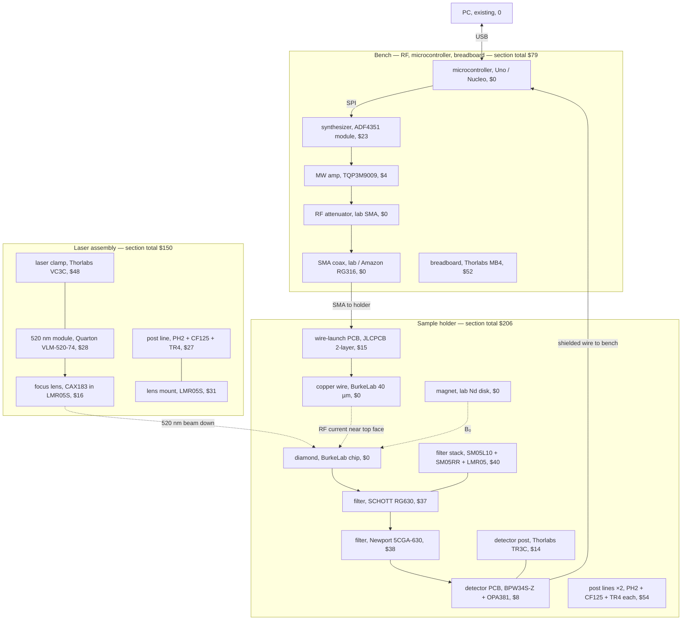

## Apparatus diagram — with costs (team design)

Same layout as [parts_diagram.md](parts_diagram.md). **Line format:** `role, part / MPN, ext $` (list USD, Oct 2026). **$0** = BurkeLab, EECS lab, or team stock unless noted.

**BOM detail:** [../parts_list.md](../parts_list.md) · **No-cost views:** [parts_diagram.md](parts_diagram.md)

| View | Section |
|------|---------|
| **Conceptual** | [below](#conceptual-signal--function-costs) |
| **Physical** | [below](#physical-build--layout-costs) |

**Pricing scope:** P0 parts you **buy** (Scenario B — full Thorlabs Tier 1, both filters, 1× amp). Ranges in BOM (e.g. 2× amp) are not shown here.

---

## Conceptual (signal & function) — costs



| Section | Subtotal (USD) |
|---------|----------------|
| Control & acquisition | **0** |
| Microwave | **42** |
| Optical pump | **44** |
| Sample | **0** |
| Detection | **83** |
| **Conceptual subassemblies (excludes bench mechanics & safety)** | **169** |

*Conceptual blocks omit Thorlabs breadboard/posts/clamps ($267 list for T1–T10) and laser safety glasses ($23). Those appear in the physical view and overall total.*

---

## Physical (build & layout) — costs

Thorlabs lines follow [parts_list.md](../parts_list.md) Tier 1 cart; **MB4** is counted under **Bench**; laser and holder posts are split per [subassembly table](parts_diagram.md#what-each-subassembly-is).



| Build unit | Subtotal (USD) | Notes |
|------------|----------------|--------|
| **Bench** | **79** | MB4 + ADF4351 + 1× amp; CTL/coax/attenuator at $0 (lab) |
| **Laser assembly** | **150** | Quarton + CAX183 + VC3C + LMR05S + one post line |
| **Sample holder** | **206** | Both filters + SM05 stack + detector ICs + wire PCB + TR3C + two post lines |
| **Physical subassemblies** | **435** | Excludes safety glasses ($23) |

---

## Overall (P0 team purchase)

| Category | Ext $ |
|----------|-------|
| Conceptual/detection + RF + optics ICs & modules (no Thorlabs mechanics) | 169 |
| Thorlabs optomechanics T1–T10 (incl. split above) | 267 |
| Laser safety glasses (Walmart O3) | 23 |
| **Overall P0 list (Scenario B)** | **~459** |

Add **~10–15% + shipping**; optional **SPW603** spanner (+$13) and **2nd TQP3M9009** (+$4) not included. Full vendor tables: [parts_list.md](../parts_list.md#orders-by-vendor).

### Stack (top → bottom) — line items

```text
  [ laser beam from above ]
           ↓
      ┌─────────┐
      │ Diamond │  sample, BurkeLab, $0
      ├─────────┤
      │  RG630  │  filter, SCHOTT RG630, $37
      ├─────────┤
      │ 5CGA-630│  filter, Newport 5CGA-630, $38
      ├─────────┤
      │  BPW34  │  photodiode, BPW34S-Z, $4
      │ OPA381  │  TIA, OPA381AIDGKR, $4
      └─────────┘
   wire PCB, 15 · Burke wire, 0 · SM05/LMR05/TR3C/mechanics in holder subtotal
```
