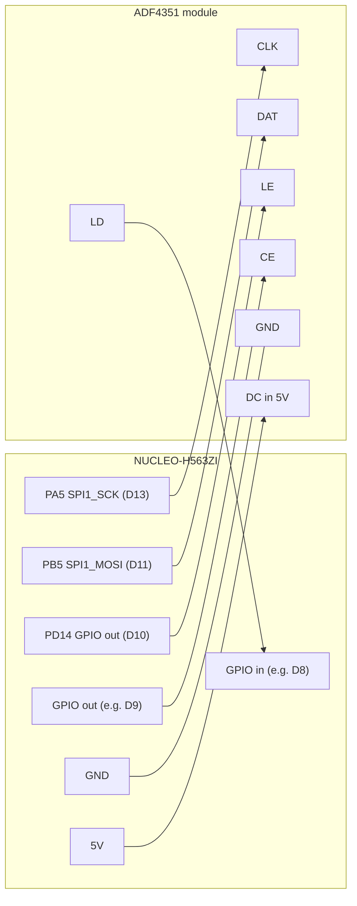

## Wiring (verify the pins against UM3115, the NUCLEO-H563ZI user manual, and the module's silkscreen)

- Connect the grounds together. If the module has a 3V3 header pin, do **not** also feed it from the Nucleo while the DC jack is powered.
- MISO isn't used, because the ADF4351 can't be read back. You can optionally route MUXOUT to a GPIO input instead.
