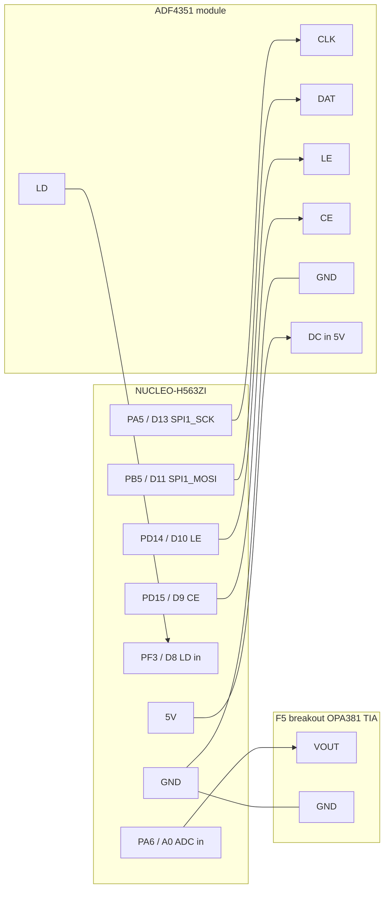

## Wiring (NUCLEO-H563ZI)

Verify every net against **UM3115** (Nucleo-144 MB1404), the **ADF4351 module silkscreen**, and your **F5** breakout layout before powering on.

**PoC needs these Nucleo connections:** SPI to the synthesizer, one **ADC** input for the TIA, **GPIO** for ADF4351 **CE** / **LD** (optional **MUXOUT**). **USB** debug/logging uses the on-board **STLINK-V3EC** virtual COM port — no extra UART pins. **Laser, amp, coax, and Burke antenna** are **power-only / RF** (no MCU pins).

---

### Pin map (P0 — CW ODMR)

| Nucleo (Arduino) | STM32 | Direction | Connect to |
|------------------|-------|-----------|------------|
| **D13** | PA5 | Out | ADF4351 **CLK** (SPI SCK) |
| **D11** | PB5 | Out | ADF4351 **DAT** / **MOSI** (SPI MOSI) |
| **D10** | PD14 | Out | ADF4351 **LE** (latch enable; bit-banged after each 32-bit word) |
| **D9** | PD15 | Out | ADF4351 **CE** (chip enable, hold high in operation) |
| **D8** | PF3 | In | ADF4351 **LD** (lock detect; optional but useful for bring-up) |
| **A0** | PA6 | In | **OPA381** output (TIA voltage → **ADC12_INP3**) |
| **5V** | — | Power | ADF4351 module **VCC** (if module expects 5 V on “DC in”) |
| **GND** | — | — | Common ground: Nucleo, ADF4351, **F5** breakout, laser return, amp return |

**Not used on P0:** SPI MISO (ADF4351 has no readback). **3V3** on the ADF4351 module: follow the board label — if **5 V** is supplied on the power jack, do **not** also tie a separate **3V3** header to the Nucleo unless the module datasheet requires it.

**Optional:** Route **MUXOUT** to another **GPIO input** instead of **LD** if you configure MUXOUT as lock detect in **R2–R5**.

---

### ADF4351 (SPI + control)

- **Logic levels:** Most ADF4351 boards expect **3.3 V** SPI/control. Nucleo **D13/D11/D10/D9** are **3.3 V** I/O — match module docs (level shifters if the board is 5 V logic only).
- **Firmware:** Load **R5→R0** over SPI; sweep frequency by updating **R0** (and **R1** if needed); sample **A0** while stepping **f**.

---

### Detector (OPA381 → ADC)

- Run a **short shielded or twisted pair** from **OPA381 VOUT** to **A0 (PA6)**; **AGND** / signal ground at the breakout should meet Nucleo **GND** at one point near the board.
- **OPA381** is powered from your **analog supply** (often **3.3 V** or **5 V** per breakout — see [OPA381 datasheet](https://www.ti.com/product/OPA381)). Keep **VOUT** within **0 V … 3.3 V** at **PA6** (gain/resistor choice or a simple clamp if the TIA swings high on bright PL).
- **ADC:** **ADC12** channel **3** (**PA6**). Calibrate ADC per RM0481 / HAL before trusting absolute volts; PoC only needs **relative PL** vs frequency.

**No Nucleo pins** to **BPW34** (photovoltaic mode into TIA) or to the **filters/diamond** stack.

---

### No MCU pins (P0)

| Item | Connection |
|------|------------|
| **TQP3M9009** amp | **RF in/out** + **5 V** supply (module board) |
| **SMA coax** | **Amp → Burke antenna** (SMA male to Burke **SMA female**) |
| **Quarton VLM-520-74** | **Power** (and onboard driver); CW PoC — no TTL enable in BOM |
| **Burke MW antenna** | **SMA only** |
| **Thorlabs / filters** | Mechanical/optical only |

---

### Deferred / P1 (extra Nucleo pins if you add hardware)

| If you add | Typical MCU role | Notes |
|------------|------------------|--------|
| **HMC284** MW switch (**M8**) | **GPIO** pulse (e.g. **D2** / **PG14** on CN10 — pick a free **D*** ) | Mariani: TTL to switch **VCTL**; needs pulsed firmware |
| **Laser TTL enable** | **GPIO** (when Quarton/driver exposes enable) | Not required for CW PoC |
| **IVC102** integrator | **GPIO** S/H or integration control | Stretch / Mariani path |
| **Scope debug** | **TIA VOUT** probed on bench | Does not use Nucleo |

Pick unused **CN7/CN10** **D*** pins for P1; update this table when you assign them.

---

### References

- [parts_diagram.md](parts_diagram.md) — signal flow  
- [parts_list.md](../parts_list.md) — ordered parts  
- Firmware skeleton: [nucleo-driver/Src/main.c](../../nucleo-driver/Src/main.c)
